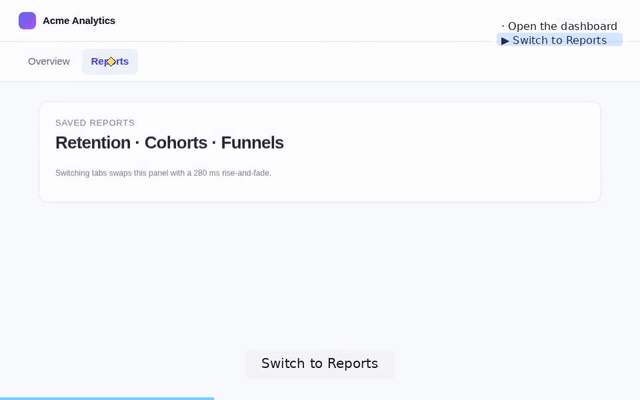

# screencast-reel

**When to use:** the reel is for a human — a demo, a changelog post, a bug
report, a landing page. A slideshow of settled screenshots is fine for a CI
artifact, but it cannot show a panel sliding open, a tab cross-fading, or
characters appearing as they are typed. Screencast capture records the page
continuously; reel grammar makes the actions legible on top of it.



Full 30 fps MP4: [`reel.mp4`](reel.mp4) (8.7 s, 261 frames, 275 KB).

## Command

The reel above was generated from the self-contained page in [`site/`](site/)
— no network, no external assets:

```bash
cd demo/screencast-reel/site && python -m http.server 8000 &
clickcast run demo/screencast-reel/scenario.yml \
  --var base_url=http://127.0.0.1:8000 \
  --out demo/screencast-reel/reel.mp4
```

The interesting part is three lines of [`scenario.yml`](scenario.yml):

```yaml
meta:
  render:
    format: mp4
    capture: screencast   # continuous Chromium frames (CDP Page.startScreencast)
    smooth: true          # reel grammar: press cue, ripple, captions, timeline
    video_fps: 30
```

`--smooth` does not retime anything here — screencast frames are already
continuous — it opts into the grammar pass. Without it the reel is the raw
footage.

The pointer is the one thing the recorder only samples per step: `cursor_xy`
changes at action boundaries, so a click-to-click jump of several hundred
pixels would otherwise land in a single frame. The render pipeline therefore
caps cursor travel at `CursorStyle.max_speed_px_s` (default **1600 px/s**),
carries the last known pointer through untracked frames, and inserts easing
glide frames where needed. This reel grew from 214 to 261 frames because of
those glides — the page footage is untouched, and every glide frame has a
distinct cursor position, so it does not regress the duplicate metric.

Same scenario, stills backend, for comparison:

```bash
clickcast run demo/screencast-reel/scenario.yml \
  --var base_url=http://127.0.0.1:8000 \
  --capture shots --out demo/screencast-reel/reel-shots.mp4
```

## Measured

`scripts/bench_motion.py` — a frame pair is a duplicate when fewer than 0.01%
of its pixels changed by more than 4/255 levels:

| artifact | frames | unique | duplicates | size |
|---|---|---|---|---|
| `reel-shots.mp4` — `--capture shots` | 193 | 22.9% | 77.1% | 101 KB |
| `reel.mp4` — `--capture screencast` | 261 | **55.8%** | 44.2% | 275 KB |

Nearly half of the screencast reel is still held frames, and that is correct:
the dwells after each action are reading time, not padding. The motion lives
inside each transition, where the frames are all distinct (the 300 ms reveal,
the 600 ms bars, every typed character, and the pointer glides).

## What each layer contributes

| Layer | Source | Visible in the reel |
|---|---|---|
| Page motion | `--capture screencast`: the compositor pushes a frame on change | panel reveal, tab fade, bars growing, per-keystroke characters, pulsing sync dot |
| Press cue + ripple | reel grammar, drawn at the recorded `cursor_xy` | a click is identifiable in a still frame |
| Captions | reel grammar, from each step's `label` | "Expand the breakdown", "Type a filter", … |
| Timeline | reel grammar | progress along the bottom edge |
| Cursor | synthetic overlay at `cursor_xy`, speed-capped with inserted glide frames | a pointer that travels across the page instead of teleporting |

## Honest limits

- **Chromium only.** `Page.startScreencast` is a CDP API; Firefox and WebKit
  fail fast with a documented error instead of silently downgrading to stills.
- **Not byte-reproducible.** Frame count follows wall time and compositor
  updates, so this backend is property-tested (unique %, duration bounds, step
  attribution) rather than golden-frame tested. Use `--capture shots` when you
  need deterministic output.
- **Cross-document navigation is still a cut.** There are no frames between
  two documents; the grammar pass slides them editorially. Everything inside a
  document is real footage.
- **The page is a fixture.** It is committed so the demo is reproducible and
  the motion is the point, not the marketing copy.
