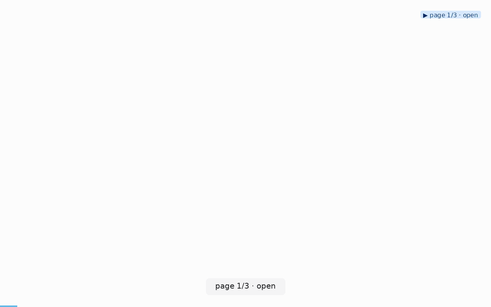

# clickcast

**Playwright browser automation, screenshots, and GIF/MP4/WebP recording for AI agents** — with a machine-readable JSON sidecar and a live MCP server for step-by-step browser control.

<p>
<a href="https://pypi.org/project/clickcast/"></a>
<a href="https://github.com/AlexKay28/clickcast"></a>
</p>



Agents are blind on the web. A screenshot is expensive and unaddressable; a DOM dump is unbounded. clickcast runs a real Chromium/Firefox/WebKit session and returns **two things at once**: a reel a human can watch, and a structured sidecar an agent can gate on — selectors, timing, console errors, failed requests, accessibility data, and page state, per step.

## Install

```bash
pip install clickcast          # Python library + CLI
pip install 'clickcast[mcp]'   # adds the MCP server
npx -y clickcast-mcp           # same MCP server, no Python install
clickcast install              # fetch browser engines (wraps playwright install)
```

## First run (30 seconds)

```bash
clickcast auto https://example.com --out tour.gif
```

For a reel a human will actually watch — continuous page motion plus cursor,
click and caption cues — switch to the screencast preset:

```bash
clickcast auto https://example.com -o tour.mp4 --format mp4 \
  --capture screencast --smooth --video-fps 30
```

Two files land next to each other:

- `tour.gif` — the reel
- `tour.gif.json` — the **sidecar**: schema **v5**, strictly additive from v1, validated by a committed JSON Schema

```json
{
  "schema_version": 5,
  "steps": [
    {"index": 0, "action": "goto",  "status": "ok", "duration_ms": 812.4},
    {"index": 1, "action": "click", "status": "ok", "duration_ms": 581.3,
     "args": {"selector": "role=link[name=\"Pricing\"]"},
     "delta": {"added": [], "removed": [], "text_changes": [], "settled": {"ok": true, "ms": 506}}}
  ]
}
```

`steps[].delta` is populated on live MCP sessions; batch runs carry `delta: null`, so the block is purely optional and older sidecars parse unchanged.

## The agent loop: `observe → act → settle → receipt`

Live control through MCP is token-bounded end to end, so an agent can iterate dozens of times without filling its context window.

| Call | What you get | Ceiling |
|---|---|---|
| `observe` | ranked snapshot of what you can act on, addressed by stable `ref=eN` handles | ≤800 est. tokens, ≤20 nodes |
| `click(ref=…)` | one action plus a `delta`: added/removed nodes, text changes, errors, layout shift, `settled` | ≤300 est. tokens |
| `settle` | "has the page stopped changing?" across network, DOM mutations and compositor activity | timeouts reported, never hangs |
| `receipt` | one artifact directory (reel, v5 sidecar, assertions, visual diff) + a summary | ≤200 est. tokens |

[Full loop documentation →](perception.html) · [MCP tool reference →](mcp-tool-schema.html)

## Batch mode: scenarios, assertions, CI

```bash
clickcast run tour.yml --emit-events --out tour.gif   # declarative YAML scenario
clickcast elements https://example.com                # what can be clicked here?
clickcast explore https://example.com                 # state graph, no encoding
clickcast assertions tour.gif.json --baseline base.json   # exits non-zero on drift
clickcast diff tour.gif.json baseline.gif.json            # pixel-level drift
clickcast report-bug tour.gif.json                    # turn a sidecar into a bug report
```

`--smooth --video-fps 30` produces a real 30 fps MP4 instead of a slideshow. Region annotations are declarative, so highlights are reproducible rather than hand-drawn.

## Python API

```python
from clickcast import Reel

Reel("https://example.com", viewport=(1280, 800), fps=12).goto(wait="networkidle").click(
    "#cta", label="Open pricing"
).save("tour.gif")
```

`AsyncReel` mirrors it with `await`. `Reel.observe()` and `Reel.receipt()` expose the live loop from the SDK.

## Documentation

- [For AI agents](for-agents.html) — the shortest path from install to a gated sidecar
- [Perception loop](perception.html) — `observe → act → settle → receipt` and the artifact layout
- [MCP tool schema](mcp-tool-schema.html) — every tool, argument and error code
- [Feedback schema](feedback-schema.html) — the sidecar contract, v1 → v5
- [Benchmarks](benchmarks.html) — the two headline numbers, measured
- [Smooth video](smooth-video.html) — 30 fps MP4 reels and declarative annotations
- [AI integration](ai-integration.html) — wiring clickcast into an agent loop

## Source

[github.com/AlexKay28/clickcast](https://github.com/AlexKay28/clickcast) · MIT · [PyPI](https://pypi.org/project/clickcast/) · [llms.txt](llms.txt)
